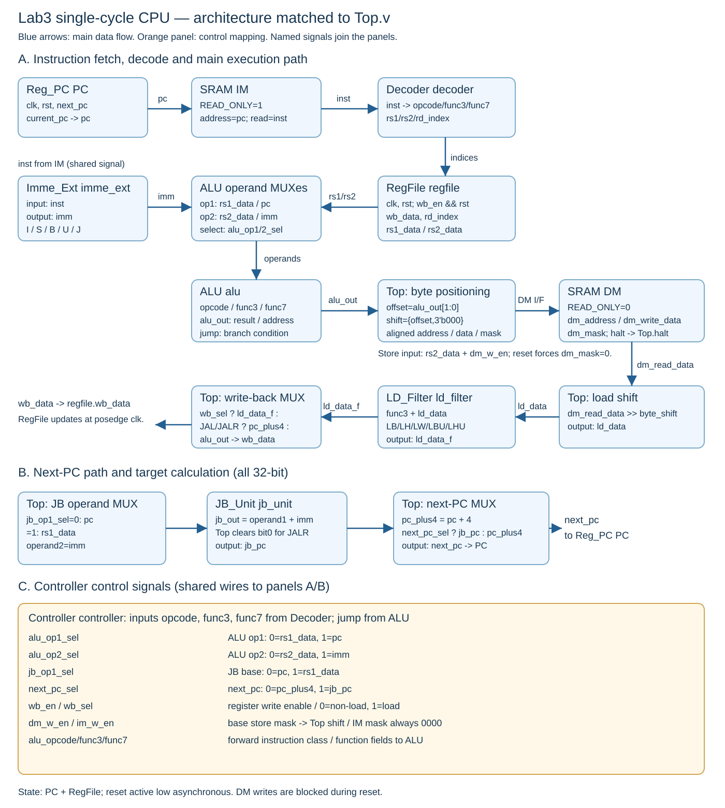

# Lab 3 Assignment Report

## Student Information

Please enter your name and student ID below.

- Student Name: **彭靖翔**
- Student ID: **E24144773**

You may answer in English or Traditional Chinese. Explain your own implementation and refer to its signal names where helpful.

## CPU Implementation (20 pts)

1. **CPU architecture diagram:** Draw a diagram of your single-cycle CPU showing its modules, main datapath connections, and control signals. You may draw it by hand or use draw.io. Include a clear image in this report.
2. **Module implementation:** Explain how you implemented each of the nine modules: Reg_PC, RegFile, Decoder, Imme_Ext, ALU, JB_Unit, LD_Filter, Controller, and Top. Describe the main logic of each module and how Top connects them to form the CPU.

### Your Answer

### 1. CPU architecture diagram

本 CPU 為 32-bit 單週期設計。架構圖分成主要資料路徑、next-PC 與控制訊號三區，三區是同一顆 CPU，透過相同訊號名稱連接。IF/ID/EX/MEM/WB 為同一週期內的工作；PC 與 RegFile 在上升緣更新。

#### 主要資料與控制連接

- `pc`：PC.current_pc → IM.address；PC+4、ALU/JB 的 PC 輸入。目前指令位址。
- `inst`：IM.read_data → Decoder.inst、Imme_Ext.inst。同一條指令供解碼與立即數產生。
- `rs1_data / rs2_data`：RegFile → ALU operand MUX；rs1 → JB MUX；rs2 → store shift。提供運算、分支與 store 來源。
- `imm`：Imme_Ext → ALU operand2 MUX、JB_Unit.operand2。立即數或已重組位移。
- `alu_out`：ALU → 記憶體定位邏輯及非 load 寫回路徑。結果或有效 byte address。
- `jump`：ALU → Controller.jump。branch 成立條件。
- `dm_read_data → ld_data → ld_data_f`：DM → Top 右移 → LD_Filter → wb_data。load 定位與擴展。
- `wb_data`：Top 寫回 MUX → regfile.wb_data。邊緣更新 rd。
- `jb_out → jb_pc → next_pc`：JB → JALR bit0 修正 → Next-PC MUX → PC.next_pc。控制流更新。

#### 控制訊號編碼

- `next_pc_sel`：0:pc_plus4；1:jb_pc；branch 看 jump，JAL/JALR 為1。
- `jb_op1_sel`：0:pc；1:rs1_data；JALR 為1。
- `alu_op1_sel`：0:rs1_data；1:pc；AUIPC 為1。
- `alu_op2_sel`：0:rs2_data；1:imm；I/load/store/LUI/AUIPC 為1。
- `wb_en`：1 啟用 rd 寫入；Top 再 AND rst；store/branch 為0；x0 仍禁止寫。
- `wb_sel`：0:非load；1:ld_data_f；非load 額外判斷 JAL/JALR 選 pc_plus4。
- `dm_w_en`：SB=0001；SH=0011；SW=1111；Top 位移並在 reset 清零。
- `im_w_en`：固定0000；執行期間禁止寫 IM。
- `alu_opcode/func3/func7`：轉送操作欄位至 ALU；與 Decoder 的介面寬度相符。

### 2. Module implementation

#### Reg_PC

Reg_PC 是保存目前指令位址的 32-bit 狀態元件。使用 always @(posedge clk or negedge rst)；rst=0 時以非阻塞指派將 current_pc 清為零，否則在時脈上升緣更新為 next_pc。

在 Top 內使用指定 instance 名稱 PC，current_pc 接至 pc；next_pc 先由 Top 選擇。因此本模組不自行固定加 4，能接收循序或跳轉位址。

#### RegFile

RegFile 宣告 reg [31:0] registers [0:31]，提供兩個組合讀埠與一個上升緣寫埠。低有效非同步 reset 會清除所有暫存器；正常時只有 wb_en 且 rd_index!=0 才更新目的暫存器。

registers[0] 持續保持零，讀取 index=0 時也直接輸出零。其餘讀取依 rs1_index、rs2_index 取得對應元素，不受 wb_en 限制。Top 的 instance 名為 regfile，寫入使能接 wb_en && rst。x2 不設特殊初值，由 runtime 初始化。

#### Decoder

Decoder 為純組合欄位擷取：dc_out_opcode=inst[6:2]、dc_out_func3=inst[14:12]、dc_out_func7=inst[30]，rs1/rs2/rd 索引分別取 inst[19:15]、inst[24:20]、inst[11:7]。

本介面 opcode 只有 5 bits、func7 只有 1 bit。Top 將操作欄位送給 Controller，索引送給 RegFile；某些格式不使用的來源欄位仍可擷取，由後續 MUX 忽略。

#### Imme_Ext

Imme_Ext 從 inst[6:2] 判斷格式，沒有額外 ImmSel port。I 型取 inst[31:20]；S 型拼接 inst[31:25] 與 inst[11:7]。B 型依 inst[31]、inst[7]、inst[30:25]、inst[11:8]、0 重組；J 型依 inst[31]、inst[19:12]、inst[20]、inst[30:21]、0 重組。

I/S/B/J 皆符號延伸至 32 bits；B/J 已包含最低位 0，不再額外左移。U 型使用 {inst[31:12],12'b0}。組合邏輯先給預設零，所有路徑完整賦值；imm 在 Top 同時供給 ALU operand2 MUX 與 JB_Unit。

#### ALU

ALU 在組合 always 先令 alu_out=0、jump=0，再依 opcode 與 func3 選擇操作。R/I 型支援加減、位移、比較、XOR、OR、AND；SUB 只在 R-type 且 func7=1 時使用，避免將負數 ADDI 的 bit30 誤判為減法。

SLT 與 BLT/BGE 以 $signed 比較；SLTU 與 BLTU/BGEU 使用無號比較。位移量只取 operand2[4:0]；SRA 使用 $signed(operand1) >>>，SRL 使用 >>。load/store 與 AUIPC 做加法，LUI 直接傳 operand2。

branch 類別依 func3 輸出 BEQ/BNE/BLT/BGE/BLTU/BGEU 的 jump，非 branch 保持 jump=0。條件比較與跳轉位址分開，位址由 JB_Unit 計算。

#### JB_Unit

JB_Unit 是 32-bit 組合加法器，輸出 jb_out=operand1+operand2。Top 依 jb_op1_sel 決定 operand1 使用 pc 或 rs1_data，operand2 接 imm。

branch 與 JAL 使用 pc+imm；JALR 使用 rs1_data+imm，Top 再將 jb_out 最低位清零形成 jb_pc。JB_Unit 本身不解碼指令，也不再對 imm 做額外位移。

#### LD_Filter

LD_Filter 接收已由 Top 右移定位的 ld_data，依 func3 決定 load 寬度。LB 將 bit7 符號延伸，LH 將 bit15 符號延伸；LBU/LHU 高位補零；LW 原值通過，其他選項輸出零。

模組沒有位址輸入，不負責 byte lane 選擇。Top 先做 dm_read_data >> byte_shift，再送入 LD_Filter，確保擴展使用正確符號位。ld_data_f 最後經寫回 MUX 送入 RegFile。

#### Controller

Controller 是組合控制邏輯，先設定安全預設：不寫 rd/IM/DM，PC 選循序路徑，ALU 預設 rs1/rs2，並轉送 alu_opcode、alu_func3、alu_func7。每種指令再覆寫必要控制，避免保留上一條指令的控制值。

R-type、I-type、load、LUI、AUIPC、JAL/JALR 啟用 wb_en；store 與 branch 不啟用。I/load/store/LUI/AUIPC 選 imm；AUIPC 的 ALU 第一輸入選 pc。branch 的 next_pc_sel=jump，JAL/JALR 無條件選跳轉，JALR 的 jb_op1_sel=1。

wb_sel=1 代表 load，非 load 使用 0；JAL/JALR 的 PC+4 寫回由 Top 額外判斷。SB/SH/SW 的基本 dm_w_en 分別為 0001/0011/1111，位移由 Top 完成；im_w_en 固定 0000。

#### Top

Top 實例化九個模組中的其餘八個以及兩個提供的 SRAM。保留 PC、regfile、IM、DM 名稱。IM 使用 READ_ONLY=1，DM 使用 READ_ONLY=0；PC 與 RegFile 接 clk/rst，兩個 SRAM 接 clk。

取指後 inst 同時送 Decoder 與 Imme_Ext；RegFile 輸出 rs1_data、rs2_data。alu_op1_sel 決定 pc 或 rs1_data，alu_op2_sel 決定 imm 或 rs2_data；ALU 計算結果與 branch 的 jump。

pc_plus4=pc+4；JB_Unit 依基底與 imm 產生 jb_out，JALR 清 bit0 得 jb_pc。next_pc=next_pc_sel ? jb_pc : pc_plus4。寫回則為 load 選 ld_data_f，JAL/JALR 選 pc_plus4，其餘選 alu_out。

資料記憶體使用 byte_offset=alu_out[1:0]、byte_shift={byte_offset,3'b000}、dm_address={alu_out[31:2],2'b00}。store 資料左移 byte_shift，基本 mask 左移 byte_offset；rst=0 時最終 dm_mask=0000。load 將 dm_read_data 右移 byte_shift 後交 LD_Filter。

支援題目保證不跨 word 的 byte、halfword、word 存取，包括 halfword offset 1。DM.halt 直接接 Top.halt；IM 的 halt 在本實作接未使用的 im_halt_unused wire，不驅動 CPU 結束。此與題目示範留空的效果相同。結束由正常 store 將 byte 1 寫至 0xFFFFFFFB 觸發，不需要 ECALL。

### Instruction examples

- ADDI：addi x5,x0,10。IM → Decoder/Imme_Ext → RegFile → ALU → wb_data → RegFile。預期：x5=10；next_pc=pc+4。
- LH at offset1：低16位資料需從 word 的 byte1 起讀。ALU 位址 → word 對齊 → DM → 右移8 → LH 符號延伸 → rd。預期：符號位取右移後 bit15；不跨 word。
- SH at offset1：rs2 低halfword=0x1234。mask0011<<1=0110；rs2<<8；上升緣只寫指定 lanes。預期：byte1=34、byte2=12，其餘保持。
- BEQ taken：PC=0x100、imm=-8、來源相等。ALU.jump=1 → Controller → JB 以PC加imm → next_pc。預期：next_pc=0xF8；不寫 rd。
- JAL：PC=0x100、imm=8。JB 算目標108；寫回另選pc_plus4。預期：rd=0x104；next_pc=0x108。

### Verification evidence

提供的完成版專案中，`build/Testing/Temporary/LastTest.log` 記錄以下七項本機測試通過：

| Test | Recorded result |
| --- | --- |
| print_test | PASS |
| msort_test | PASS |
| qsort_test | PASS |
| matmul_test | PASS |
| malloc_test_test | PASS |
| isa_edges_test | PASS |
| partial_access_test | PASS |

這些是隨專案保存的測試紀錄，不等同最終提交 commit 的正式評分。驗證目前 RTL 時，需先執行 `cmake --build build -j 4`，再執行 `ctest --test-dir build --output-on-failure --no-tests=error`。CrossVerify 逐指令比較 PC、32 個暫存器及記憶體存取相關狀態；預期完整成功訊息為 `100% tests passed, 0 tests failed out of 7`。

## Reflection Report (0 pts)

Please write a short reflection about the lab:

1. What did you learn from completing this assignment?
2. What challenges did you encounter, and how did you address them?
3. What feedback would you like to give the TAs about this lab?

### Your Reflection

#### 1. What did you learn from completing this assignment?

透過這次單週期 CPU 的實作，我理解到 RISC-V 指令的行為必須透過資料路徑與控制訊號共同完成。不同類型的指令可以共用 RegFile、ALU 與立即數產生器，但需要正確選擇運算元、寫回來源與下一個 PC。單週期設計中的取指、解碼、執行、必要的記憶體讀取及寫回準備都在同一週期內進行，而 PC 與暫存器等狀態在時脈邊緣更新。我也更清楚組合邏輯與時序邏輯的差別，以及非同步 reset、x0 保護與完整組合賦值的重要性。

#### 2. What challenges did you encounter, and how did you address them?

這份實作的關鍵挑戰是讓多種指令共用資料路徑時仍保持正確，尤其是部分記憶體存取與控制流。CPU 使用 byte address，但 SRAM 一次處理一個 32-bit word，因此我在 Top 中分別產生對齊位址、byte offset 與位移量，將 store 資料及 byte mask 一起左移，將 load 資料右移後再交給 LD_Filter 擴展。這樣能讓記憶體位置處理與符號延伸的責任清楚分開，也支援題目要求的 halfword offset 1。

另一個需要注意的地方是解碼欄位的意義會隨指令類型改變。例如 ADDI 的 bit30 屬於立即數，不能一律當成 SUB 控制；JALR 的目標需要清除 bit0，且 JAL/JALR 寫回的是 PC+4。我透過明確區分 opcode 類別、統一 Controller 與 Top 的 MUX 編碼，以及把跳轉目標與寫回路徑分開，處理這些情況。專案附帶的七項 PASS 紀錄可作為既有驗證證據；最終提交仍應對目前程式重新建置與測試。

#### 3. What feedback would you like to give the TAs about this lab?

逐指令 CrossVerify 與指令邊界、部分記憶體存取測試，有助於確認 CPU 不只是最後輸出正確，也能在中間每個步驟維持正確狀態。建議增加一組已知錯誤的示範，例如 byte mask 未位移或 JALR 目標處理錯誤，並搭配 mismatch 訊息與波形，示範如何從第一個差異追查到控制或資料路徑。若另附一張標示必要階層名稱與介面寬度的檢查表，也能幫助學生在整合前確認平台相容性。

