# Lab 3 Assignment Report

## Student Information

Please enter your name and student ID below.

- Student Name: **彭靖翔**
- Student ID: **E24144773**

You may answer in English or Traditional Chinese. Explain your own implementation and refer to its signal names where helpful.

## CPU Implementation (20 pts)

1. **CPU architecture diagram:** Draw a diagram of your single-cycle CPU showing its modules, main datapath connections, and control signals. You may draw it by hand or use draw.io. Include a clear image in this report.
2. **Module implementation:** Explain how you implemented each of the nine modules: Reg_PC, RegFile, Decoder, Imme_Ext, ALU, JB_Unit, LD_Filter, Controller, and Top. Describe the main logic of each module and how Top connects them to form the CPU.

### Your Answer

#### 1. CPU Architecture Diagram

畫出單週期 CPU 架構圖，呈現各模組、主要資料路徑與控制訊號。

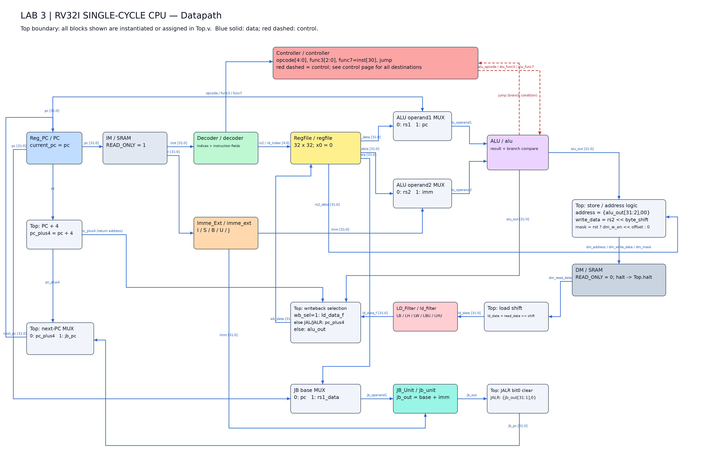

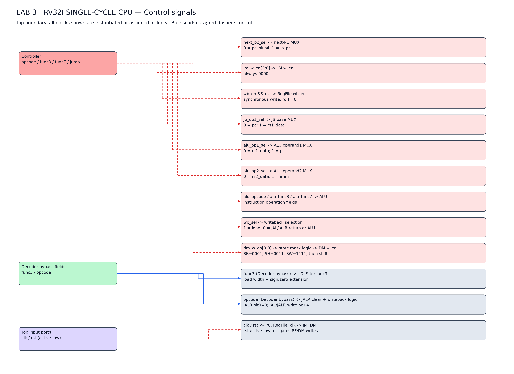

本 CPU 為 RV32I 單週期設計，由 Top 連接 Reg_PC、RegFile、Decoder、Imme_Ext、ALU、JB_Unit、LD_Filter 與 Controller。Top 是包住整個架構的第九個模組，不是資料流中額外的一個運算方塊。圖中的各個指定模組以不同顏色區別；SRAM 為灰色，Top 內 assign 實作的多工器、加法器、位移器及遮罩邏輯為淡灰色。藍色實線表示資料傳送方向，紅色虛線表示控制與分支判斷。圖二補齊所有控制目的端，以免主資料圖被大量控制線遮蔽。線路交叉不表示相連，箭頭端點才表示目的端。

Reg_PC 的 pc 同時送到 IM、PC+4、ALU 第一輸入多工器與 JB 基底多工器。IM 的 inst 送到 Decoder 與 Imme_Ext；前者拆出來源／目的暫存器索引與指令欄位，後者產生 32 位元 imm。RegFile 的雙讀埠在同一週期提供 rs1_data、rs2_data，ALU 依控制訊號選擇暫存器、PC 或立即數進行運算。

算術指令將 alu_out 寫回；Load 將 ALU 位址對齊後讀取 DM，先依位元組偏移右移，再由 LD_Filter 作符號或零延伸，最後寫回 rd。Store 將 rs2_data 與寫入遮罩同步左移，確保僅改寫正確 byte lane。這些額外邏輯是完成版實際程式的一部分，不能把 DM 直接連到 LD_Filter 而省略位移。

分支時 ALU 比較 rs1 與 rs2，將 jump 傳回 Controller；同時 JB_Unit 計算 pc+imm。只有條件成立才選擇 jb_pc；否則選擇 pc+4。JAL 固定跳轉至 pc+imm；JALR 改用 rs1+imm 並清除 bit0。兩者寫回 pc+4，不能誤畫成寫回跳轉目標或 ALU 結果。

PC 與 RegFile 於 clk 正緣更新，DM 於正緣依 byte mask 寫入；讀取與運算路徑為組合邏輯。rst 為低有效非同步重置，Top 額外以 rst 關閉 RF 與 DM 寫入。此架構沒有五級管線暫存器，取指、解碼、執行、記憶體及回寫是單一週期中的組合路徑。

#### 控制訊號與設計理由

| 訊號 | 目的端 | 意義 |
| --- | --- | --- |
| next_pc_sel | next-PC MUX | 0 = pc_plus4; 1 = jb_pc |
| im_w_en[3:0] | IM.w_en | always 0000 |
| wb_en && rst | RegFile.wb_en | synchronous write, rd != 0 |
| jb_op1_sel | JB base MUX | 0 = pc; 1 = rs1_data |
| alu_op1_sel | ALU operand1 MUX | 0 = rs1_data; 1 = pc |
| alu_op2_sel | ALU operand2 MUX | 0 = rs2_data; 1 = imm |
| alu_opcode / alu_func3 / alu_func7 | ALU | instruction operation fields |
| wb_sel | writeback selection | 1 = load; 0 = JAL/JALR return or ALU |
| dm_w_en[3:0] | store mask logic -> DM.w_en | SB=0001; SH=0011; SW=1111; then shift |
| func3 (Decoder bypass) | LD_Filter.func3 | load width + sign/zero extension |
| opcode (Decoder bypass) | JALR clear + writeback logic | JALR bit0=0; JAL/JALR write pc+4 |
| clk / rst | PC, RegFile; clk -> IM, DM | rst active-low; rst gates RF/DM writes |

Decoder 的 opcode 僅為 inst[6:2]（5 bits），func7 僅為 inst[30]（1 bit）；不能套用一般教材的完整 7-bit opcode／funct7 標法。func3 直接接 LD_Filter，不是 Controller 產生的另一個輸出。byte_offset=alu_out[1:0]，byte_shift={byte_offset,3'b000}；圖中的 shift 即 byte_shift。

#### 指令結果推導

以下為人工依 RTL 推導的示例，並非宣稱新增測試已實際執行。

##### ADDI x5,x1,-4

假設 pc=0x100、x1=10。alu_op1_sel=0、alu_op2_sel=1、wb_en=1、wb_sel=0，imm=0xFFFFFFFC；alu_out=6，正緣後 x5=6、PC=0x104。負立即數的 bit30 不應令 ADDI 變成 SUB。

##### BEQ x1,x2,+16

假設 pc=0x100，且 x1=x2。ALU jump=1，Controller next_pc_sel=1；JB_Unit 算出 0x110，下一個 PC=0x110。若不相等則 PC=0x104；兩種情況均不寫 rd、不寫 DM。

##### JALR x1,3(x2)

假設 pc=0x100、x2=0x200。jb_op1_sel=1，jb_out=0x203，清除最低位後 jb_pc=0x202；x1 寫回 0x104。這是 JALR 目標公式示範；此平台另檢查 PC 必須四位元組對齊，若要接續執行，請使用四位元組對齊的跳轉目標。

##### LB 與 LBU，非零 offset

假設 rs1+imm=0x80000001、DM 對齊讀回 0x12348078。byte_offset=1、byte_shift=8，ld_data=0x00123480。LB 結果=0xFFFFFF80；LBU 結果=0x00000080。先位移才能取得正確符號位。

##### SB，非零 offset

假設有效位址=0x80000002、rs2_data=0xAB。dm_address=0x80000000，byte_shift=16，dm_write_data=0x00AB0000，dm_mask=0100；僅第 2 號 byte lane 被寫入。

#### 2. Module Implementation

以下依 finished(4) 的實際 RTL 說明九個模組的主要邏輯，以及 Top 如何將模組連接為完整 CPU。各流程圖中的分支代表互斥選擇或並行硬體，不代表每格各佔一個時脈週期。

#### 2.1 Reg_PC — PC 暫存器：保存目前指令位址

##### 主要邏輯與 Top 連接

此模組是時序邏輯。always @(posedge clk or negedge rst) 同時支援時脈正緣與低有效非同步重置；rst 拉低時不需要等待下一個 clk 就將 PC 歸零。rst 為 1 時，每個正緣採用 next_pc。

使用非阻塞指派 <=，讓 PC 與 RegFile 在同一正緣更新架構狀態。模組本身不決定是否跳轉，也不自行加 4；這兩項由 Top 的組合邏輯提供。

Top 以 Reg_PC PC 實例連接 .next_pc(next_pc)、.current_pc(pc)。pc 接 IM.address、PC+4、ALU 的 PC 選項與 JB 基底；next_pc 由 next_pc_sel 在 pc_plus4 和 jb_pc 間選擇。

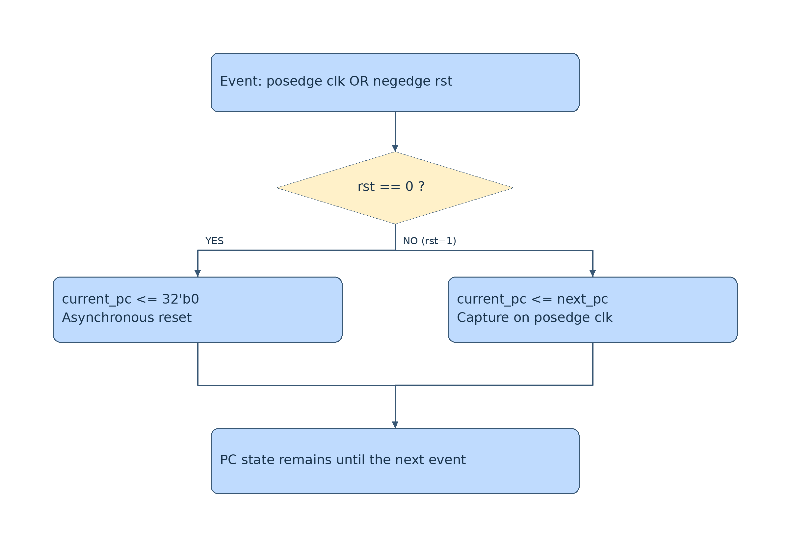

##### 依 RTL 推導的範例

若 rst=0，PC=0；解除重置後，假設 next_pc=0x00000004，下一正緣 PC 才變成 4。非正緣且沒有重置信號下降時，PC 保持不變。

##### 實際程式碼

來源：`rtl/src/Reg_PC.v`。以下保留完整原始碼，供對照上方關鍵邏輯。

```verilog
// Lab3 RV32I 單周期 CPU｜中文註解實作
module Reg_PC (
	input clk,
	input rst,
	input [31:0] next_pc,
	output reg [31:0] current_pc
);

// 低有效、非同步重置；每個正緣提交一條指令的下一個 PC。
always @(posedge clk or negedge rst) begin
    if (!rst) current_pc <= 32'b0;
    else current_pc <= next_pc;
end

endmodule
```

#### 2.2 RegFile — 暫存器檔：兩個組合讀埠、一個同步寫埠

##### 主要邏輯與 Top 連接

以 reg [31:0] registers [0:31] 保存 32 個 32 位元暫存器。讀取位於獨立 always @(*)，因此 rs1_index／rs2_index 改變時，讀出值經組合邏輯更新，不需等待時脈。圖中讀取與寫入是兩條並行機制，不表示讀取完成後才啟動寫入。

寫入由 posedge clk 觸發；rst=0 時以迴圈清空所有暫存器。正常運作時強制 registers[0]<=0，且只有 wb_en && rd_index != 0 才寫入，讀埠也對索引 0 直接輸出零，形成 x0 的讀寫雙重保護。

Top 將 Decoder 的三個索引接入 RegFile，wb_data 接回寫資料，寫入使能接 wb_en && rst。rs1_data 供 ALU／JB；rs2_data 供 ALU／Store。測試平台透過 regfile.registers 觀察狀態，故實例與陣列名稱需保留。

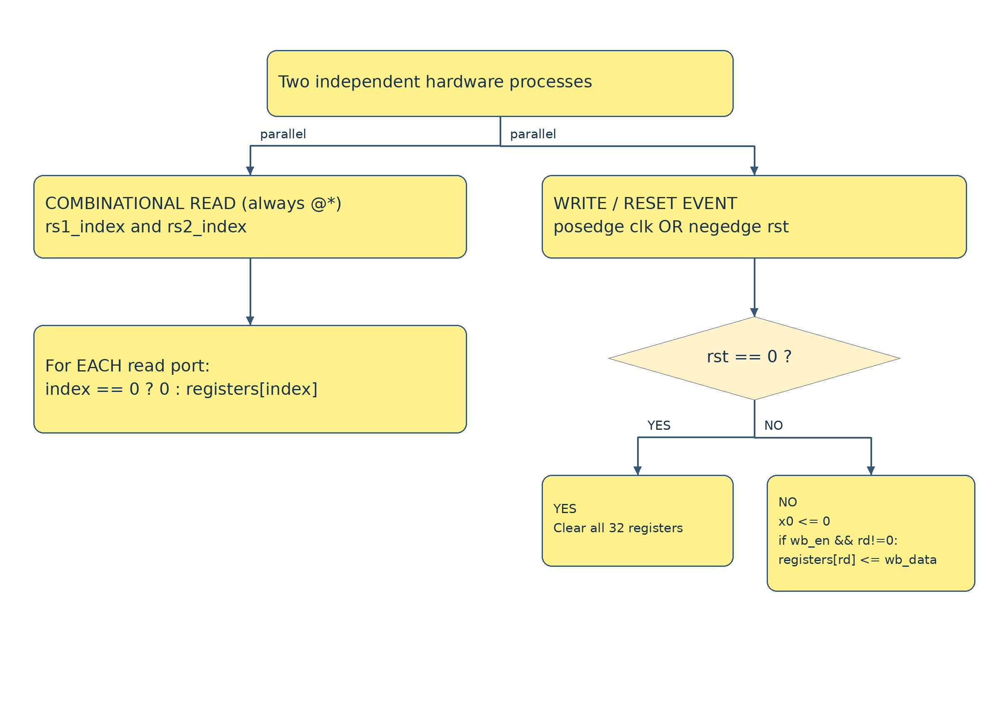

##### 依 RTL 推導的範例

假設 x1=10、x2=3，讀埠同週期提供 10 與 3。wb_en=1、rd_index=5、wb_data=13 時，下一正緣 x5=13；若 rd_index=0，x0 仍為 0。

##### 實際程式碼

來源：`rtl/src/RegFile.v`。以下保留完整原始碼，供對照上方關鍵邏輯。

```verilog
// Lab3 RV32I 單周期 CPU｜中文註解實作
module RegFile (
	input clk,
	input rst,
	input wb_en,
	input [31:0] wb_data,
	input [4:0] rd_index,
	input [4:0] rs1_index,
	input [4:0] rs2_index,
	output reg [31:0] rs1_data_out,
	output reg [31:0] rs2_data_out
);

// 平台透過 regfile.registers 讀取架構狀態，名稱不可更改。
reg [31:0] registers [0:31];
integer i;
// 寫入在正緣發生；非阻塞指派讓本周期仍讀取舊的來源暫存器。
always @(posedge clk or negedge rst) begin
    if (!rst) begin
        for (i = 0; i < 32; i = i + 1) registers[i] <= 32'b0;
    end else begin
        // x0 是硬接線的零；任何試圖寫入 x0 的指令都不改變它。
        registers[0] <= 32'b0;
        if (wb_en && rd_index != 5'b0) registers[rd_index] <= wb_data;
    end
end
// 雙讀埠為組合邏輯，同一周期即可供 ALU、分支及 store 使用。
always @(*) begin
    rs1_data_out = (rs1_index == 0) ? 32'b0 : registers[rs1_index];
    rs2_data_out = (rs2_index == 0) ? 32'b0 : registers[rs2_index];
end

endmodule
```

#### 2.3 Decoder — 指令欄位拆解：保留本作業的欄位寬度

##### 主要邏輯與 Top 連接

本模組使用組合邏輯直接擷取固定欄位，沒有時脈與內部狀態。dc_out_opcode 僅取 inst[6:2]，寬度為 5；dc_out_func7 僅取 inst[30]，寬度為 1，不能描述成完整 7-bit opcode 或完整 funct7。

所有輸出在 always @(*) 中皆有指定值，因此不需要保存上一條指令的解碼結果。即使某類指令不使用 rs2 或 rd，欄位仍照樣輸出；是否實際讀取／寫回由指令控制邏輯決定。

Top 將 inst 同時送 Decoder 與 Imme_Ext。Decoder 的 opcode／func3／func7 接 Controller；索引接 RegFile；func3 另外直接接 LD_Filter，opcode 另外供 JALR 清最低位與跳轉回寫判斷。

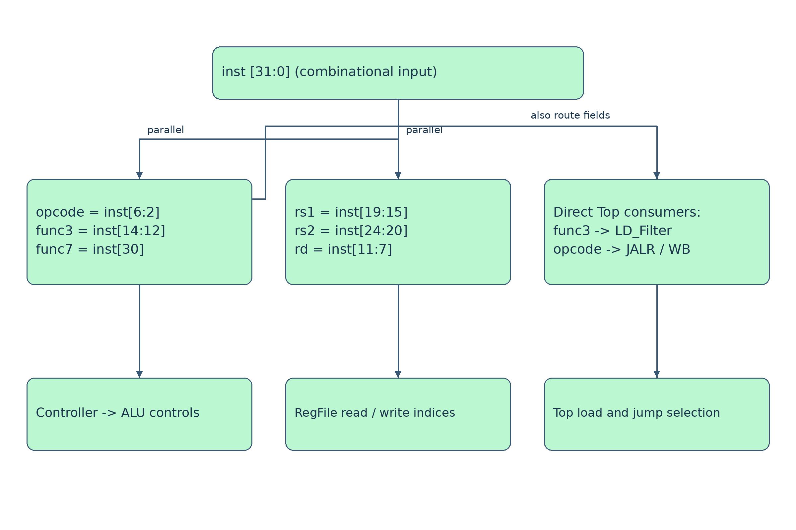

##### 依 RTL 推導的範例

ADDI x5,x1,-4 的 inst=0xFFC08293：opcode=00100、func3=000、func7=1、rs1_index=1、rd_index=5。此時 rs2_index 擷取到立即數位元但不被用作 ALU 第二運算元。

##### 實際程式碼

來源：`rtl/src/Decoder.v`。以下保留完整原始碼，供對照上方關鍵邏輯。

```verilog
// Lab3 RV32I 單周期 CPU｜中文註解實作
module Decoder (
	input [31:0] inst,
	output reg [4:0] dc_out_opcode,
	output reg [2:0] dc_out_func3,
	output reg dc_out_func7,
	output reg [4:0] dc_out_rs1_index,
	output reg [4:0] dc_out_rs2_index,
	output reg [4:0] dc_out_rd_index
);

// 本作業 opcode 只取 [6:2]；func7 只取 bit30，並非完整七位欄位。
// 固定位置的欄位直接接出；不使用的欄位由 Controller 忽略。
always @(*) begin
    dc_out_opcode = inst[6:2];
    dc_out_func3 = inst[14:12];
    dc_out_func7 = inst[30];
    dc_out_rs1_index = inst[19:15];
    dc_out_rs2_index = inst[24:20];
    dc_out_rd_index = inst[11:7];
end

endmodule
```

#### 2.4 Imme_Ext — 立即數產生：重組位元並延伸成 32 位元

##### 主要邏輯與 Top 連接

本模組以 opcode 選擇 I、S、B、U、J 格式。I 型使用 inst[31:20]；S 型組合 inst[31:25] 與 inst[11:7]，再複製 inst[31] 進行符號延伸。

B 型重組為 {inst[31],inst[7],inst[30:25],inst[11:8],0}；J 型重組為 {inst[31],inst[19:12],inst[20],inst[30:21],0}。兩者最低位已加入零，JB_Unit 不得再額外左移一次。U 型把高 20 位放到 [31:12]、低 12 位補零。

輸出 imm 在 Top 同時接 ALU 第二輸入多工器與 JB_Unit.operand2。I 型涵蓋立即數算術、Load、JALR；ALU 的移位指令只使用 operand2[4:0] 作移位量。預設值與 default 分支避免 latch。

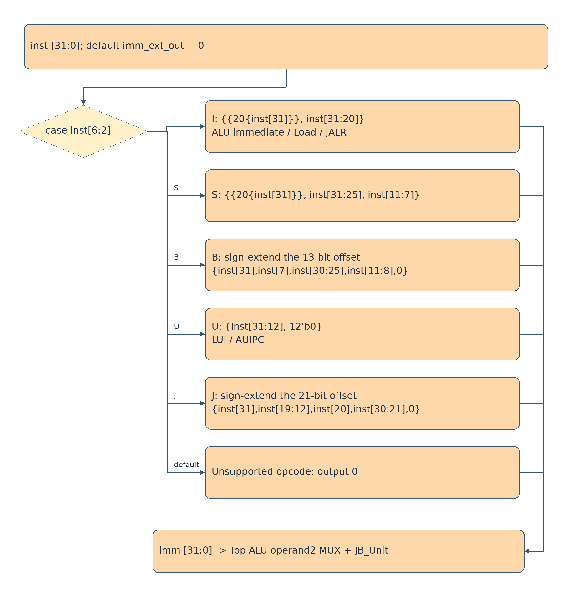

##### 依 RTL 推導的範例

I 型 -4 產生 0xFFFFFFFC；B 型 +16 產生 0x00000010；LUI 高 20 位為 0x12345 時，imm=0x12345000。

##### 實際程式碼

來源：`rtl/src/Imme_Ext.v`。以下保留完整原始碼，供對照上方關鍵邏輯。

```verilog
// Lab3 RV32I 單周期 CPU｜中文註解實作
module Imme_Ext (
	input [31:0] inst,
	output reg [31:0] imm_ext_out
);

// 每條指令自行決定立即數格式；分支及 JAL 的 bit0 固定為零。
// 所有輸出完整賦值，避免組合邏輯意外推導出 latch。
always @(*) begin
    imm_ext_out = 32'b0;
    case (inst[6:2])
        5'b00100, 5'b00000, 5'b11001: // I: ALU immediate / load / JALR
            imm_ext_out = {{20{inst[31]}}, inst[31:20]};
        5'b01000: // S: store 的立即數分散在兩個欄位
            imm_ext_out = {{20{inst[31]}}, inst[31:25], inst[11:7]};
        5'b11000: // B: 符號延伸 13-bit 位移（已包含最低位零）
            imm_ext_out = {{19{inst[31]}}, inst[31], inst[7], inst[30:25], inst[11:8], 1'b0};
        5'b01101, 5'b00101: // U: LUI / AUIPC
            imm_ext_out = {inst[31:12], 12'b0};
        5'b11011: // J: 符號延伸 21-bit 位移
            imm_ext_out = {{11{inst[31]}}, inst[31], inst[19:12], inst[20], inst[30:21], 1'b0};
        default: imm_ext_out = 32'b0;
    endcase
end

endmodule
```

#### 2.5 ALU — 算術、邏輯、位址計算與分支比較

##### 主要邏輯與 Top 連接

以 opcode 先區分指令類型，再用 func3 選擇 ADD／SUB、SLL、SLT、SLTU、XOR、SRL／SRA、OR、AND。SUB 僅在 R 型且 func7=1 時使用，避免 ADDI 負立即數的 bit30=1 被誤判成 SUB。32 位結果自然保留低 32 位。

SLT 與 BLT／BGE 將運算元轉成 $signed；SLTU 與 BLTU／BGEU 保持無號比較。SRA 使用 $signed(operand1) >>> operand2[4:0]，才能複製符號位；移位量限制為低 5 位。比較結果以 {31'b0, condition} 形成 32-bit 0 或 1。

Load／Store／AUIPC 使用加法；LUI 直接輸出 operand2。分支不在 ALU 計算目標，而是比較 operand1、operand2，依 BEQ／BNE／BLT／BGE／BLTU／BGEU 輸出 jump。

Top 接入選好的 alu_operand1／alu_operand2，Controller 轉送 alu_opcode／alu_func3／alu_func7。alu_out 供普通回寫及 DM 位址；jump 返回 Controller，僅作為分支是否選目標 PC 的判斷。Controller 對運算元選擇不依賴 jump，因此這裡沒有用 jump 反覆改變比較運算元的組合回授迴圈。

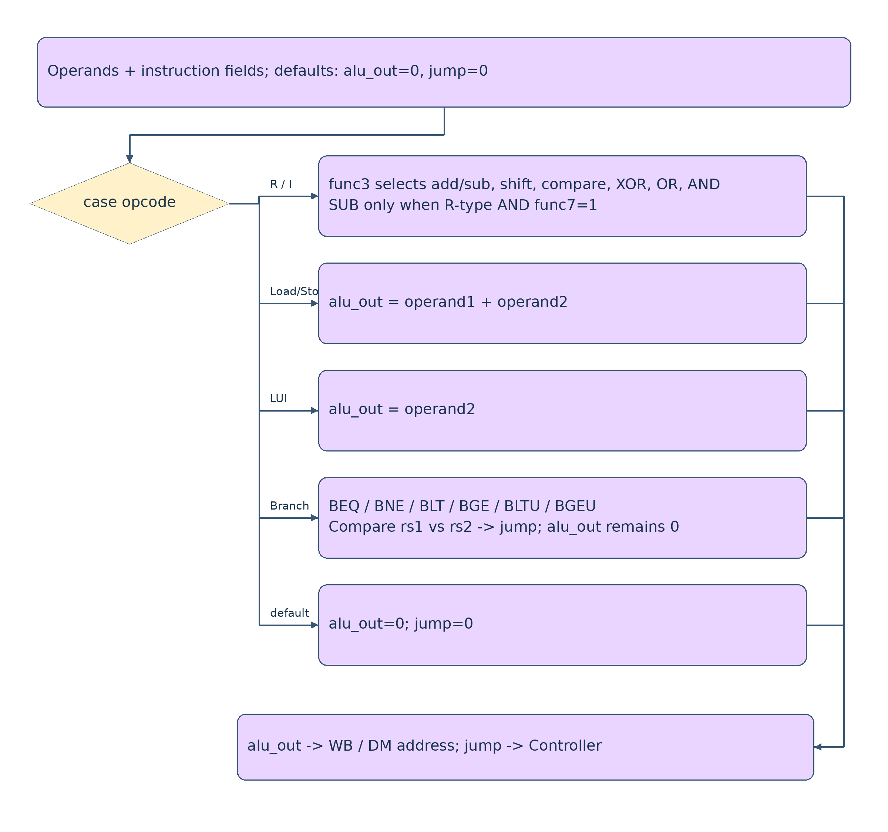

##### 依 RTL 推導的範例

ADDI：10 + (-4) = 6；SLT：0xFFFFFFFF 與 1 以有號比較得 1，SLTU 則得 0；SRA：0x80000000 算術右移 1 得 0xC0000000。

##### 實際程式碼

來源：`rtl/src/ALU.v`。以下保留完整原始碼，供對照上方關鍵邏輯。

```verilog
// Lab3 RV32I 單周期 CPU｜中文註解實作
module ALU (
	input [4:0] opcode,
	input [2:0] func3,
	input func7,
	input [31:0] operand1,
	input [31:0] operand2,
	output reg [31:0] alu_out,
	output reg jump
);

// opcode 是 inst[6:2]；所有結果保持 32 bits，自然保留模 2^32 結果。
always @(*) begin
    alu_out = 32'b0;
    jump = 1'b0;
    case (opcode)
        5'b01100, 5'b00100: begin // R-type 與 I-type 算術
            case (func3)
                // I-type bit30 屬立即數，ADDI 不可因它為 1 而變成 SUB。
                3'b000: alu_out = (opcode == 5'b01100 && func7)
                                   ? operand1 - operand2 : operand1 + operand2;
                3'b001: alu_out = operand1 << operand2[4:0];
                // 比較輸出只有 bit0 有意義，其餘 31 bits 補零。
                3'b010: alu_out = {31'b0, ($signed(operand1) < $signed(operand2))};
                3'b011: alu_out = {31'b0, (operand1 < operand2)};
                3'b100: alu_out = operand1 ^ operand2;
                // >>> 必須搭配 signed 左運算元，才能複製符號位。
                3'b101: begin
                    if (func7) alu_out = $signed(operand1) >>> operand2[4:0];
                    else alu_out = operand1 >> operand2[4:0];
                end
                3'b110: alu_out = operand1 | operand2;
                3'b111: alu_out = operand1 & operand2;
                default: alu_out = 32'b0;
            endcase
        end
        5'b00000, 5'b01000, 5'b00101: // load/store 位址、AUIPC
            alu_out = operand1 + operand2;
        5'b01101: alu_out = operand2; // LUI 不使用 rs1
        5'b11000: begin // 分支只比較 rs1/rs2，不在這裡計算跳轉目標
            case (func3)
                3'b000: jump = (operand1 == operand2); // BEQ
                3'b001: jump = (operand1 != operand2); // BNE
                3'b100: jump = ($signed(operand1) < $signed(operand2)); // BLT
                3'b101: jump = ($signed(operand1) >= $signed(operand2)); // BGE
                3'b110: jump = (operand1 < operand2); // BLTU
                3'b111: jump = (operand1 >= operand2); // BGEU
                default: jump = 1'b0;
            endcase
        end
        default: begin alu_out = 32'b0; jump = 1'b0; end
    endcase
end

endmodule
```

#### 2.6 JB_Unit — 分支／跳躍目標加法器

##### 主要邏輯與 Top 連接

JB_Unit 的實作只有組合加法 jb_out=operand1+operand2；沒有 opcode、時脈或分支條件判斷。把比較與目標位址加法分開，使分支指令可同時比較 rs1／rs2 並計算 PC 相對目標。

Top 以 jb_op1_sel 選擇基底：0 為 pc、1 為 rs1_data。Branch／JAL 使用 pc+imm；JALR 使用 rs1+imm。JALR 清除 bit0 發生於 Top 的 jb_pc 指派，不是在 JB_Unit 內。

JB_Unit 的 jb_out 經 Top 處理成 jb_pc，再進入 next_pc 多工器；只有 next_pc_sel=1 才採用目標。ALU 的 jump 是條件判斷，與 jb_out 目標位址是不同訊號。

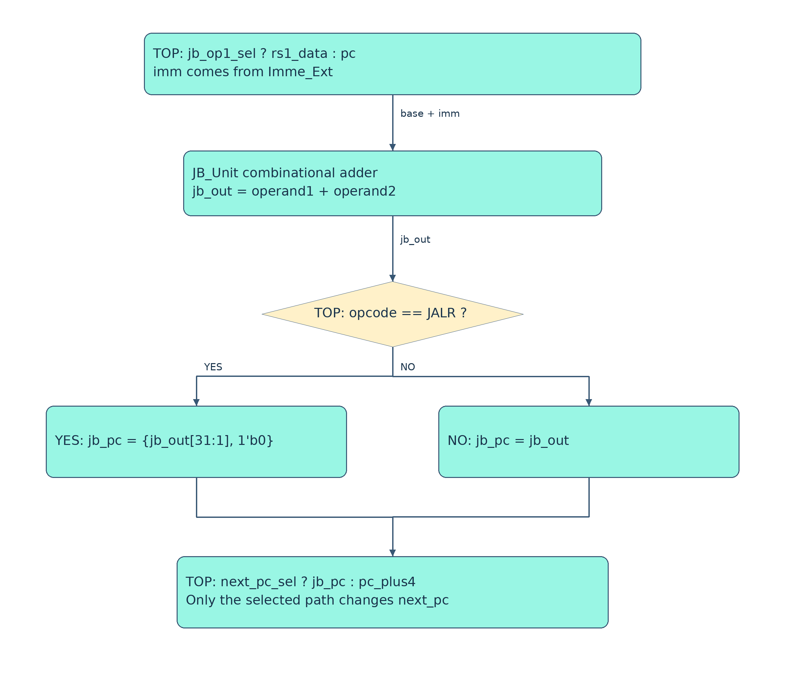

##### 依 RTL 推導的範例

pc=0x100、imm=16 時，Branch／JAL 目標為 0x110。JALR 若 rs1=0x200、imm=1，jb_out=0x201，Top 清 bit0 後 jb_pc=0x200。

##### 實際程式碼

來源：`rtl/src/JB_Unit.v`。以下保留完整原始碼，供對照上方關鍵邏輯。

```verilog
// Lab3 RV32I 單周期 CPU｜中文註解實作
module JB_Unit (
	input [31:0] operand1,
	input [31:0] operand2,
	output reg [31:0] jb_out
);

// branch/JAL 的基底是 PC，JALR 的基底是 rs1；由 Top 選擇。
// 此處只加法，JALR 清除最低位的工作留給 Top。
always @(*) begin
    jb_out = operand1 + operand2;
end

endmodule
```

#### 2.7 LD_Filter — Load 資料寬度與符號處理

##### 主要邏輯與 Top 連接

本模組只負責 Load 的寬度裁切及符號／零延伸，沒有記憶體、位址或移位器。func3=000 取低 8 位並複製 bit7，001 取低 16 位並複製 bit15，010 直接傳回完整 32 位。100／101 分別為無號 byte／halfword，補零至 32 位。

Top 必須先計算 ld_data=dm_read_data >> byte_shift，把所需位元組移到低位，再送入本模組；否則 offset 非零時會取到錯誤 byte 與錯誤符號位。

Top 將 Decoder 的 func3 直接接入 LD_Filter.func3，輸出 ld_data_f 接 wb_data 選擇邏輯；只有 Load 的 wb_sel=1 時才採用此值。其他指令即使令濾波器產生輸出，也不會因此寫回 Load 資料。

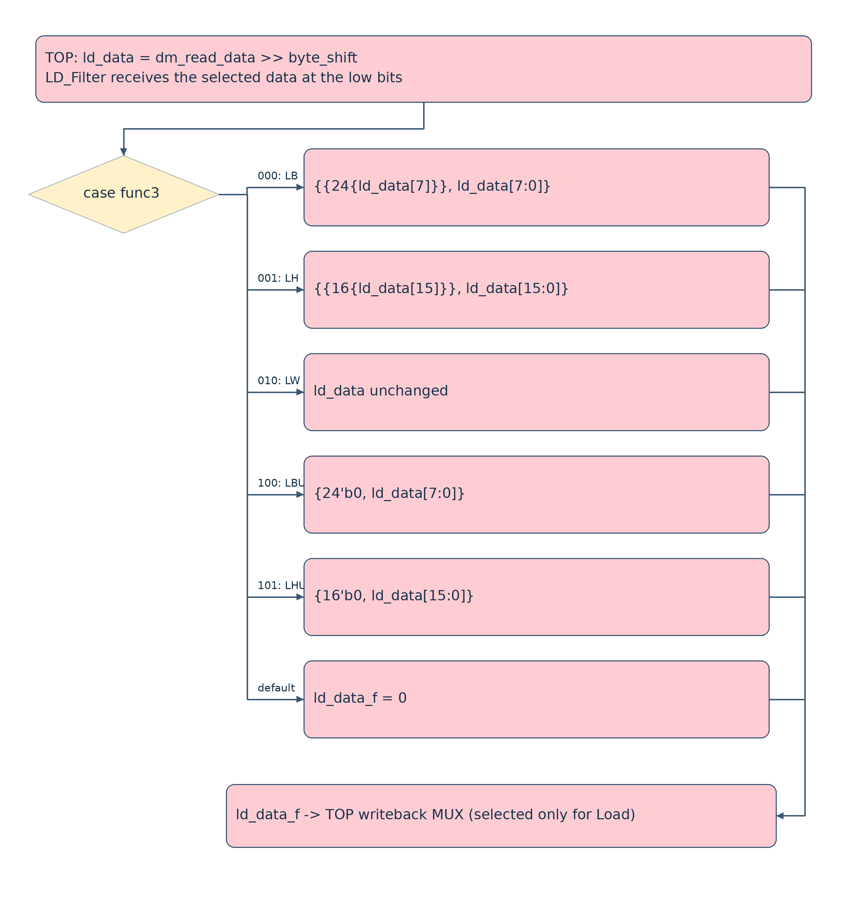

##### 依 RTL 推導的範例

若移位後 ld_data=0x00123480，LB 得 0xFFFFFF80，LBU 得 0x00000080；LH 得 0x00003480。這些例子是依位元公式推導。

##### 實際程式碼

來源：`rtl/src/LD_Filter.v`。以下保留完整原始碼，供對照上方關鍵邏輯。

```verilog
// Lab3 RV32I 單周期 CPU｜中文註解實作
module LD_Filter (
	input [2:0] func3,
	input [31:0] ld_data,
	output reg [31:0] ld_data_f
);

// Top 已把需要的 byte 移到最低位；此模組只負責寬度及符號。
always @(*) begin
    case (func3)
        3'b000: ld_data_f = {{24{ld_data[7]}}, ld_data[7:0]};   // LB
        3'b001: ld_data_f = {{16{ld_data[15]}}, ld_data[15:0]}; // LH
        3'b010: ld_data_f = ld_data;                          // LW
        3'b100: ld_data_f = {24'b0, ld_data[7:0]};             // LBU
        3'b101: ld_data_f = {16'b0, ld_data[15:0]};            // LHU
        default: ld_data_f = 32'b0;
    endcase
end

endmodule
```

#### 2.8 Controller — 控制器：依指令設定資料選擇與寫入許可

##### 主要邏輯與 Top 連接

採組合 always @(*)，先設定完整預設值：不寫 IM、不寫 RegFile、不寫 DM、PC 選 pc+4，再依 opcode 覆寫。這樣未支援 opcode 不會沿用前條指令的寫入使能；此預設行為不等於實作非法指令 trap。

R 型啟用 wb_en；I 型另選 imm；Load 啟用 wb_en、alu_op2_sel 與 wb_sel；Store 選 imm 並依 func3 輸出基本 byte mask，SB=0001、SH=0011、SW=1111。遮罩在 Controller 尚未依位址偏移平移。

Branch 的 next_pc_sel=jump；JAL 直接選目標並允許寫回；JALR 額外令 jb_op1_sel=1。LUI 選 imm；AUIPC 同時令 alu_op1_sel=1、alu_op2_sel=1，計算 pc+imm。alu_opcode／alu_func3／alu_func7 原樣轉送 ALU，im_w_en 始終為零。

Top 將 next_pc_sel、jb_op1_sel、alu_op1_sel、alu_op2_sel、wb_sel 接各組選擇邏輯；wb_en 與 rst 相與後接 RegFile；dm_w_en 經 offset 平移及 rst 保護後接 DM.w_en。wb_sel 不是一般三選一回寫編碼：跳躍回寫 pc+4 另外由 opcode 判斷。

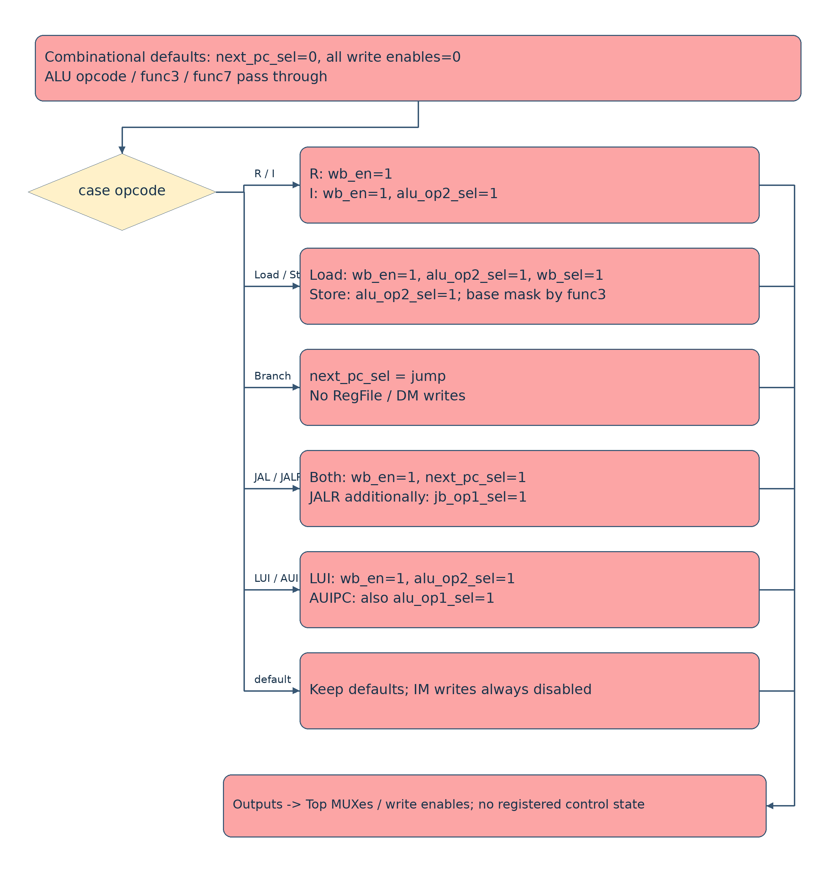

##### 依 RTL 推導的範例

Load：wb_en=1、alu_op2_sel=1、wb_sel=1、dm_w_en=0000；Store 不寫 rd，只輸出基本 mask；BEQ 只有 jump=1 才改變 PC 路徑。

##### 實際程式碼

來源：`rtl/src/Controller.v`。以下保留完整原始碼，供對照上方關鍵邏輯。

```verilog
// Lab3 RV32I 單周期 CPU｜中文註解實作
module Controller(
	input [4:0] opcode,
	input [2:0] func3,
    	input func7,
    	input jump,
	output reg next_pc_sel,
	output reg [3:0] im_w_en,
	output reg wb_en,
	output reg jb_op1_sel,
	output reg alu_op1_sel,
	output reg alu_op2_sel,
	output reg [4:0] alu_opcode,
	output reg [2:0] alu_func3,
	output reg alu_func7,
	output reg wb_sel,
	output reg [3:0] dm_w_en
);

// MUX 編碼約定（與 Top 一致）：
// jb_op1_sel: 0=PC, 1=rs1；alu_op1_sel: 0=rs1, 1=PC。
// alu_op2_sel: 0=rs2, 1=imm；wb_sel: 0=非 load, 1=load。
always @(*) begin
    // 安全預設：不寫任何記憶體、不寫暫存器、PC 往前四位元組。
    next_pc_sel = 1'b0;
    im_w_en = 4'b0000;
    wb_en = 1'b0;
    jb_op1_sel = 1'b0;
    alu_op1_sel = 1'b0;
    alu_op2_sel = 1'b0;
    alu_opcode = opcode;
    alu_func3 = func3;
    alu_func7 = func7;
    wb_sel = 1'b0;
    dm_w_en = 4'b0000;
    case (opcode)
        5'b01100: wb_en = 1'b1; // R-type
        5'b00100: begin wb_en = 1'b1; alu_op2_sel = 1'b1; end
        5'b00000: begin // Load: ALU 產生位址，回寫經 LD_Filter 處理的值
            wb_en = 1'b1; alu_op2_sel = 1'b1; wb_sel = 1'b1;
        end
        5'b01000: begin // Store: 這只是未依 offset 平移的基本 mask
            alu_op2_sel = 1'b1;
            case (func3)
                3'b000: dm_w_en = 4'b0001;
                3'b001: dm_w_en = 4'b0011;
                3'b010: dm_w_en = 4'b1111;
                default: dm_w_en = 4'b0000;
            endcase
        end
        5'b11000: next_pc_sel = jump; // 分支條件來自 ALU
        5'b11011: begin wb_en = 1'b1; next_pc_sel = 1'b1; end // JAL
        5'b11001: begin // JALR 的目標基底與 JAL 不同
            wb_en = 1'b1; next_pc_sel = 1'b1; jb_op1_sel = 1'b1;
        end
        5'b01101: begin wb_en = 1'b1; alu_op2_sel = 1'b1; end // LUI
        5'b00101: begin // AUIPC = 當前 PC + U-immediate
            wb_en = 1'b1; alu_op1_sel = 1'b1; alu_op2_sel = 1'b1;
        end
        default: begin end
    endcase
end

endmodule
```

#### 2.9 Top — 頂層整合：完成取指到回寫與 PC 更新

##### 主要邏輯與 Top 連接

Top 對外提供 clk、rst 與 halt，實例化八個功能模組及兩個 SRAM。PC、regfile、IM、DM 的階層名稱對應測試平台觀察點。Top 本身主要使用 wire 與 assign 連接組合資料路徑；真正狀態存在 PC、RegFile 與 SRAM。

取指：pc 接唯讀 IM.address，IM.read_data 為 inst。解碼：inst 同時接 Decoder 與 Imme_Ext；Decoder 索引接 RegFile，操作欄位接 Controller。運算：alu_op1_sel 在 pc／rs1_data 間選，alu_op2_sel 在 imm／rs2_data 間選，送入 ALU。

控制轉移：pc_plus4=pc+4；jb_operand1 依 jb_op1_sel 選 pc 或 rs1_data；JB_Unit 加 imm 得 jb_out；JALR 時清 bit0 得 jb_pc；next_pc_sel 選 jb_pc 或 pc_plus4。

記憶體：byte_offset=alu_out[1:0]，byte_shift={byte_offset,3'b000}，dm_address 清低兩位以對齊 word。Store 資料 rs2_data 與 Controller 基本遮罩分別左移 byte_shift 和 byte_offset，rst=0 時遮罩為零。Load 先將 dm_read_data 右移 byte_shift，再經 LD_Filter。此實作以存取不跨 word 為前提，不包含讀取第二個 word 的處理。

回寫：wb_sel=1 選 ld_data_f；否則若為 JAL／JALR，選 pc_plus4；其餘選 alu_out。RegFile 正緣依 wb_en&&rst 寫入非零 rd，PC 正緣更新 next_pc，Store 同一正緣依遮罩寫入 DM。halt 來自 DM 的輸出，是本平台記憶體映射結束機制，並非額外的 RV32I HALT 指令。

圖上的順序是資料依賴，不是五個不同時脈週期。正常單週期執行時，組合邏輯在兩個有效正緣間傳播，下一正緣提交狀態；因此時脈週期必須容納最慢的組合路徑。此設計沒有 IF/ID 等管線暫存器，也不需要 pipeline forwarding／hazard stall。

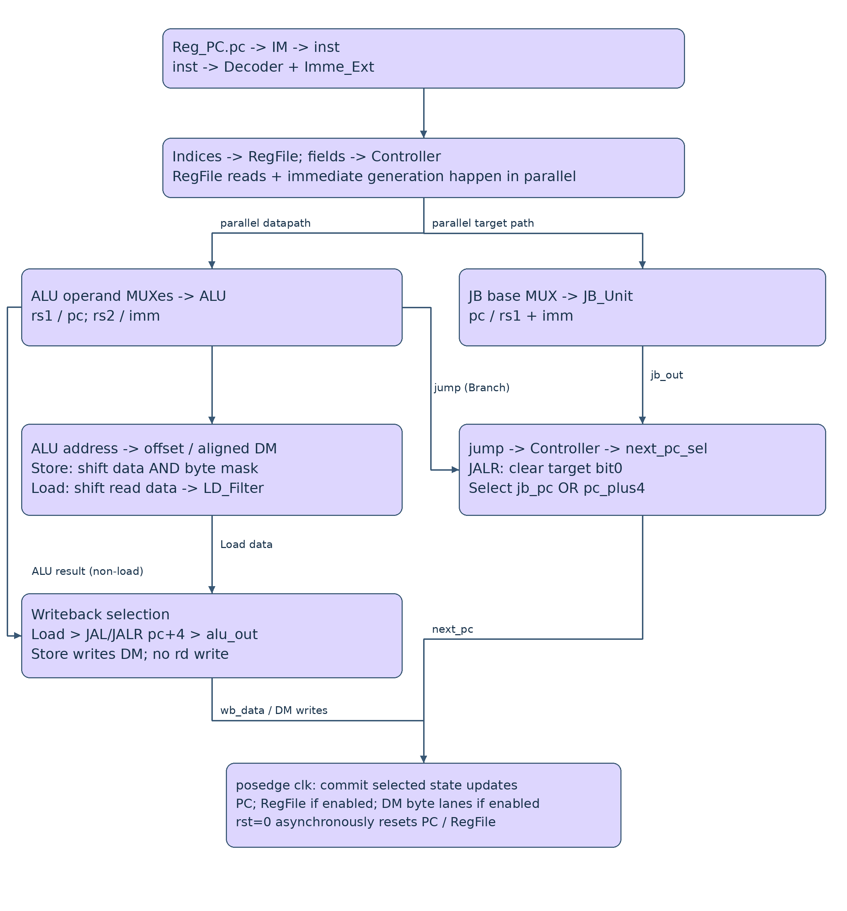

##### 依 RTL 推導的範例

LW 範例：x1=0x80000000、imm=4 → ALU=0x80000004 → DM 對齊讀取 → byte_shift=0 → LD_Filter 傳回 word → wb_data=ld_data_f → 正緣寫入 rd，PC 同時增加 4。

##### 實際程式碼

來源：`rtl/src/Top.v`。以下保留完整原始碼，供對照上方關鍵邏輯。

```verilog
// Lab3 RV32I 單周期 CPU｜中文註解實作
module Top(
    input clk,
    input rst,
    output halt
);

// 平台會透過階層名稱讀取 PC、regfile、IM、DM，以下名稱須保留。
wire [31:0] pc, pc_plus4, next_pc, inst, imm;
wire [4:0] opcode, rs1_index, rs2_index, rd_index;
wire [2:0] func3;
wire func7;
wire [31:0] rs1_data, rs2_data, alu_operand1, alu_operand2, alu_out;
wire jump, next_pc_sel, wb_en, jb_op1_sel, alu_op1_sel, alu_op2_sel, wb_sel;
wire [4:0] alu_opcode;
wire [2:0] alu_func3;
wire alu_func7;
wire [3:0] im_w_en, dm_w_en, dm_mask;
wire [31:0] jb_operand1, jb_out, jb_pc;
wire [31:0] dm_address, dm_write_data, dm_read_data, ld_data, ld_data_f, wb_data;
wire im_halt_unused;
wire [1:0] byte_offset;
wire [4:0] byte_shift;

assign pc_plus4 = pc + 32'd4;
assign next_pc = next_pc_sel ? jb_pc : pc_plus4;
Reg_PC PC (.clk(clk), .rst(rst), .next_pc(next_pc), .current_pc(pc));
// 程式由 testbench 載入 IM.rom；CPU 執行期間不寫 IM。
SRAM #(.READ_ONLY(1)) IM (
    .clk(clk), .w_en(im_w_en), .address(pc), .write_data(32'b0),
    .read_data(inst), .halt(im_halt_unused)
);
Decoder decoder (
    .inst(inst), .dc_out_opcode(opcode), .dc_out_func3(func3), .dc_out_func7(func7),
    .dc_out_rs1_index(rs1_index), .dc_out_rs2_index(rs2_index), .dc_out_rd_index(rd_index)
);
Imme_Ext imme_ext (.inst(inst), .imm_ext_out(imm));
RegFile regfile (
    .clk(clk), .rst(rst), .wb_en(wb_en && rst), .wb_data(wb_data),
    .rd_index(rd_index), .rs1_index(rs1_index), .rs2_index(rs2_index),
    .rs1_data_out(rs1_data), .rs2_data_out(rs2_data)
);
Controller controller (
    .opcode(opcode), .func3(func3), .func7(func7), .jump(jump),
    .next_pc_sel(next_pc_sel), .im_w_en(im_w_en), .wb_en(wb_en),
    .jb_op1_sel(jb_op1_sel), .alu_op1_sel(alu_op1_sel), .alu_op2_sel(alu_op2_sel),
    .alu_opcode(alu_opcode), .alu_func3(alu_func3), .alu_func7(alu_func7),
    .wb_sel(wb_sel), .dm_w_en(dm_w_en)
);
assign alu_operand1 = alu_op1_sel ? pc : rs1_data;
assign alu_operand2 = alu_op2_sel ? imm : rs2_data;
ALU alu (
    .opcode(alu_opcode), .func3(alu_func3), .func7(alu_func7),
    .operand1(alu_operand1), .operand2(alu_operand2), .alu_out(alu_out), .jump(jump)
);
assign jb_operand1 = jb_op1_sel ? rs1_data : pc;
JB_Unit jb_unit (.operand1(jb_operand1), .operand2(imm), .jb_out(jb_out));
// JALR 強制 bit0=0；branch/JAL 保留立即數產生器給出的位移。
assign jb_pc = (opcode == 5'b11001) ? {jb_out[31:1], 1'b0} : jb_out;

// Little-endian：SRAM 一次傳回一個 word；CPU 用低兩位選 byte lane。
assign byte_offset = alu_out[1:0];
assign byte_shift = {byte_offset, 3'b000}; // offset * 8，範圍 0/8/16/24
assign dm_address = {alu_out[31:2], 2'b00};
assign dm_write_data = rs2_data << byte_shift;
// Store mask 和資料必須一起向左平移；reset 期間禁止記憶體寫入。
assign dm_mask = rst ? (dm_w_en << byte_offset) : 4'b0000;
SRAM #(.READ_ONLY(0)) DM (
    .clk(clk), .w_en(dm_mask), .address(dm_address), .write_data(dm_write_data),
    .read_data(dm_read_data), .halt(halt)
);
// Load 先右移，再做 sign/zero extension，否則 offset 非零時會取錯符號位。
// 題目保證存取不跨 word，故不需要讀取第二個 word。
assign ld_data = dm_read_data >> byte_shift;
LD_Filter ld_filter (.func3(func3), .ld_data(ld_data), .ld_data_f(ld_data_f));
// Load 回寫資料；JAL/JALR 回寫 return address；其他指令回寫 ALU 結果。
assign wb_data = wb_sel ? ld_data_f :
                 ((opcode == 5'b11011 || opcode == 5'b11001) ? pc_plus4 : alu_out);

endmodule
```

#### Top 完整連線總表

| 來源 | 訊號／處理 | 目的端與作用 |
| --- | --- | --- |
| Reg_PC.current_pc | pc [31:0] | IM.address；PC+4；ALU 第一輸入 PC 選項；JB 基底 PC 選項 |
| IM.read_data | inst [31:0] | Decoder.inst、Imme_Ext.inst |
| Decoder | rs1_index／rs2_index／rd_index [4:0] | RegFile 的來源及目的索引 |
| Decoder | opcode[4:0]／func3[2:0]／func7[0] | Controller；func3 另接 LD_Filter；opcode 另供 Top 跳轉判斷 |
| Imme_Ext | imm [31:0] | ALU 第二輸入 imm 選項、JB_Unit.operand2 |
| RegFile | rs1_data／rs2_data [31:0] | ALU 輸入；rs1 另供 JB；rs2 另供 Store |
| Controller | alu_op1_sel／alu_op2_sel | Top 選擇 ALU 運算元 |
| Controller | alu_opcode／alu_func3／alu_func7 | ALU 控制欄位 |
| ALU | jump | Controller 產生 Branch 的 next_pc_sel |
| Controller | jb_op1_sel | Top 選 jb_operand1=rs1_data 或 pc |
| JB_Unit | jb_out → JALR 清 bit0 → jb_pc | Top next_pc 多工器 |
| Controller | next_pc_sel | Top 選 next_pc=jb_pc 或 pc_plus4 → Reg_PC |
| ALU | alu_out；byte_offset=alu_out[1:0] | DM 對齊位址與位移量；普通回寫結果 |
| Controller + RegFile | dm_w_en << byte_offset；rs2_data << byte_shift | DM.w_en／write_data；rst=0 禁止寫入 |
| DM.read_data | dm_read_data >> byte_shift → ld_data | LD_Filter.ld_data |
| LD_Filter | ld_data_f | Load 回寫 |
| Top | wb_data：Load > JAL/JALR pc+4 > alu_out | RegFile.wb_data；寫入使能 wb_en&&rst |
| Controller | im_w_en=0000 | IM 永不由 CPU 寫入 |
| Top inputs | clk、rst | PC／RegFile；clk 另接兩個 SRAM；rst 為低有效 |
| DM | halt | Top.halt，供模擬平台判斷結束 |

#### Controller 指令控制對照

以下是實際指定值；未使用的多工器仍保留預設 0。ALU 三個操作欄位對所有指令皆原樣轉送，IM 寫入使能皆為零。

| 指令 | opcode [6:2] | wb_en | ALU op1/op2 sel | JB base sel | wb_sel | next_pc_sel | dm_w_en |
| --- | --- | --- | --- | --- | --- | --- | --- |
| R | 01100 | 1 | 0 / 0 | 0 | 0 | 0 | 0000 |
| I arithmetic | 00100 | 1 | 0 / 1 | 0 | 0 | 0 | 0000 |
| Load | 00000 | 1 | 0 / 1 | 0 | 1 | 0 | 0000 |
| Store | 01000 | 0 | 0 / 1 | 0 | 0 | 0 | 依 func3 |
| Branch | 11000 | 0 | 0 / 0 | 0 | 0 | jump | 0000 |
| JAL | 11011 | 1 | 0 / 0 | 0 | 0 | 1 | 0000 |
| JALR | 11001 | 1 | 0 / 0 | 1 | 0 | 1 | 0000 |
| LUI | 01101 | 1 | 0 / 1 | 0 | 0 | 0 | 0000 |
| AUIPC | 00101 | 1 | 1 / 1 | 0 | 0 | 0 | 0000 |

#### Verification Evidence

build/Testing/Temporary/LastTest.log 記錄 10 月 22 日七項測試均為 Test Passed。此處是讀取附件既有紀錄，未在本環境重新編譯或執行，亦不等同 GitHub Actions 或官方最終分數。

CrossVerify.sv 的 check_state 比較 DUT 與 ISS 的 PC／暫存器；check_access 檢查 DM 對齊位址、byte lane 寫入資料、遮罩及 IM 不可寫入。Store 後另比對 RAM，並檢查 halt 一致性。因此測試證據與本圖的 PC 回授、寫回與部分存取路徑直接相關；七項通過並不代表窮盡所有 RV32I 輸入。

原始 print／qsort 紀錄出現重複字元（例如 HHeelllloo）。紀錄本身標記 PASS；尚未重新執行定位重複來源，因此不將該輸出改寫為乾淨字串，也不據此保證終端輸出無問題。

| 測試 | Simulation PASS 指令數 |
| --- | --- |
| print_test | 1106 |
| msort_test | 1848 |
| qsort_test | 4856 |
| matmul_test | 2991 |
| malloc_test_test | 3731 |
| isa_edges_test | 74 |
| partial_access_test | 142 |


## Reflection Report (0 pts)

Please write a short reflection about the lab:

1. What did you learn from completing this assignment?
2. What challenges did you encounter, and how did you address them?
3. What feedback would you like to give the TAs about this lab?

### Your Reflection

Please write a short reflection about the lab:

#### 1. What did you learn from completing this assignment?

透過這次實作，我更清楚理解 RV32I 單週期 CPU 如何將取指、解碼、運算、記憶體存取與回寫串接起來。我也學會區分組合邏輯與時序邏輯，並理解 Controller 如何透過控制訊號，讓相同的資料路徑支援不同指令。此外，參考模型比對讓我了解，驗證 CPU 不能只看程式最後的輸出，也需要檢查每條指令執行後的 PC、暫存器與記憶體狀態。

#### 2. What challenges did you encounter, and how did you address them?

較具挑戰性的部分是立即數重組、分支與跳躍，以及不同寬度的記憶體存取。我透過逐一對照指令格式與訊號路徑，確認立即數的符號延伸、分支條件與跳轉目標計算。對於 Load／Store，我將位址對齊、資料位移與寫入遮罩分開處理，並確認 Load 必須先移位，再進行符號或零延伸。另外，我也特別檢查 JAL／JALR 回寫的是 PC＋4，以及 JALR 必須清除目標位址的最低位元，避免混淆不同資料的用途。

#### 3. What feedback would you like to give the TAs about this lab?

這次實驗將 CPU 實作與參考模型驗證結合，讓我能更具體理解課堂上的資料路徑與控制概念。建議未來可以在說明文件中增加非零位元組偏移的 Load／Store 範例，並更明確標示各模組的訊號寬度與多工器選擇值。如果能提供一個參考模型比對失敗的除錯示範，說明如何從錯誤訊息追查對應的指令與訊號，會更有助於建立系統化的除錯方法。
